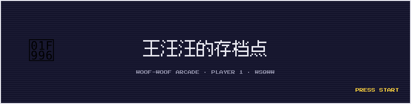
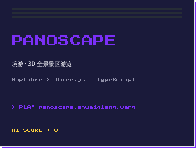
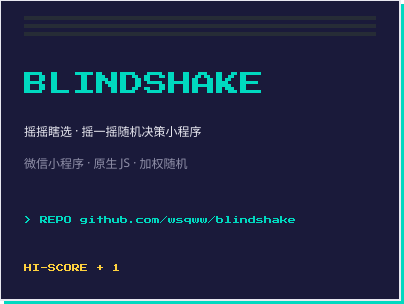
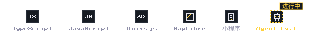

  

  

### ▸ GAME LIBRARY

<table>
  <tr>
    <td align="center">
      
    </td>
    <td align="center">
      
    </td>
  </tr>
</table>

### ▸ EQUIPMENT

  

### ▸ CONTRIBUTION SNAKE

  <picture>
    <source media="(prefers-color-scheme: dark)" srcset="https://raw.githubusercontent.com/wsqww/wsqww/output/snake-dark.svg">
    
  </picture>

  <strong>CONTINUE? ▸ <a href="mailto:wangsq0926@163.com">YES</a></strong>
   
  wangsq0926@163.com · INSERT COIN TO CONTINUE

